

# Sharpenly

**Bilingual training where every question passes a quality gate first.**
An EN/ES learning app, a manager dashboard, and the AI data-quality pipeline behind ~20,000 questions.

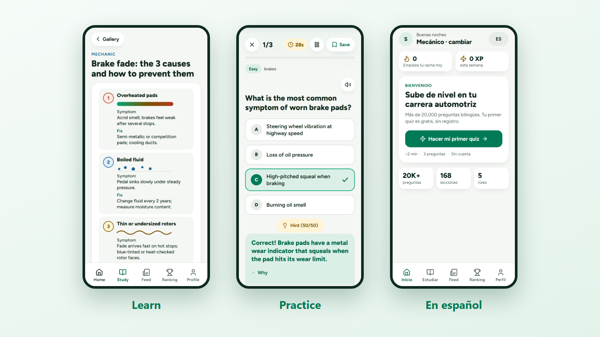

> The source of the production app is private. This repo is a curated, read-only showcase:
> screenshots, a data-quality case study, real sample questions, and trimmed code excerpts.

## Try it

- Live app: <https://app.sharpenlyapp.com>
- Website: <https://sharpenlyapp.com>
- Manager dashboard demo (no login): <https://sharpenlyapp.com/manager-preview>
- Candidate assessment demo (no login): <https://sharpenlyapp.com/candidate-preview>

### Install in 30 seconds

| Device | Steps |
|---|---|
| iPhone (Safari) | Open the app, tap Share, tap Add to Home Screen. |
| Android (Chrome) | Open the app, open the menu, tap Install app. |
| Desktop (Chrome or Edge) | Click the install icon in the address bar. |

The app works offline after the first load.

## At a glance

| What | Number |
|---|---|
| Bilingual EN/ES questions | 20,308 in 71 bank files |
| Study lessons | 168 across 21 categories |
| Difficulty levels per track | 8 |
| Shipped app versions | 174 |
| Python test functions | 458 |
| Cloud Functions | 12 |
| Commits | 730 |
| Questions the AI pipeline generated in its full batch | 11,870 |
| Accepted by the automated gate / sent to human review / rejected | 10,356 / 451 / 1,063 |
| First pilot acceptance, then after the fix | 14% (7/50), then 84% (21/25) |

## For managers

The manager dashboard shows who is trained, who is not, and where the skill gaps are. Try it without logging in: <https://sharpenlyapp.com/manager-preview>.

<picture>
  <source media="(prefers-color-scheme: dark)" srcset="docs/screenshots/dashboard-heatmap-dark.png">
  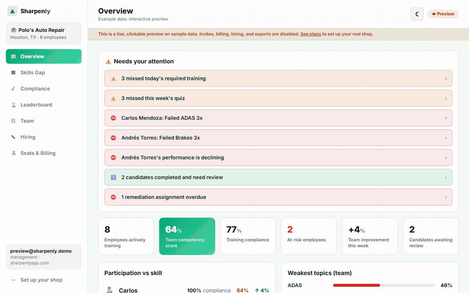
</picture>

| Feature | Status |
|---|---|
| Alerts and KPI tiles | Live |
| Skills-gap heatmap (employees by 9 topics) | Live |
| Training compliance | Live |
| Employee drill-down | Live |
| Team join code, rotate, deactivate | Live |
| CSV export | Live |
| Candidate invite links | Live |
| Candidate report card with fit rating | Live |
| Integrity trust signals (aggregate tab-hidden and paste counts, shown as "review recommended") | Live |
| Proctored stage 2 exam | Live |
| Convert a candidate to an employee | Live |
| Leaderboard | Live |
| English and Spanish, light and dark | Live |
| Auto-remediation assignments | Demo only |
| Stripe billing | Coded, not live |

<table align="center">
  <tr>
    <td>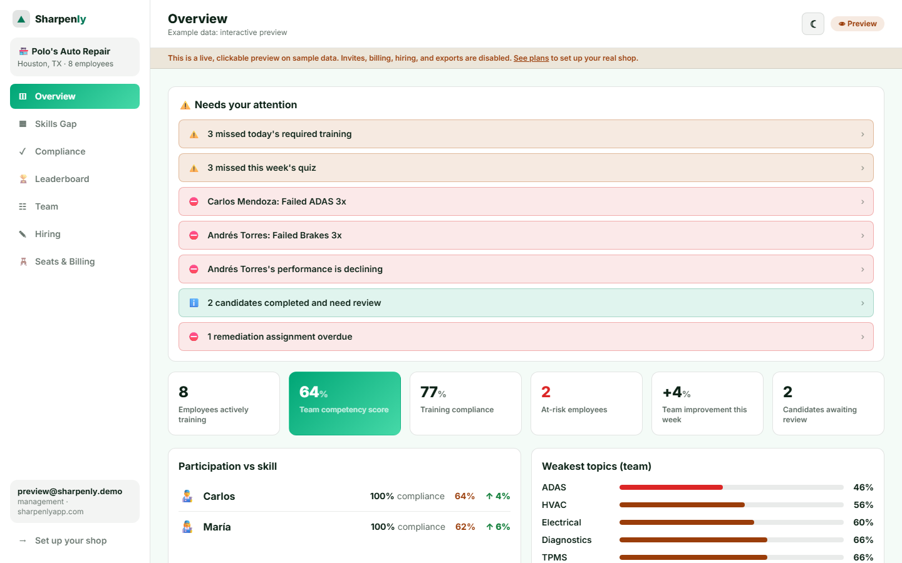</td>
    <td>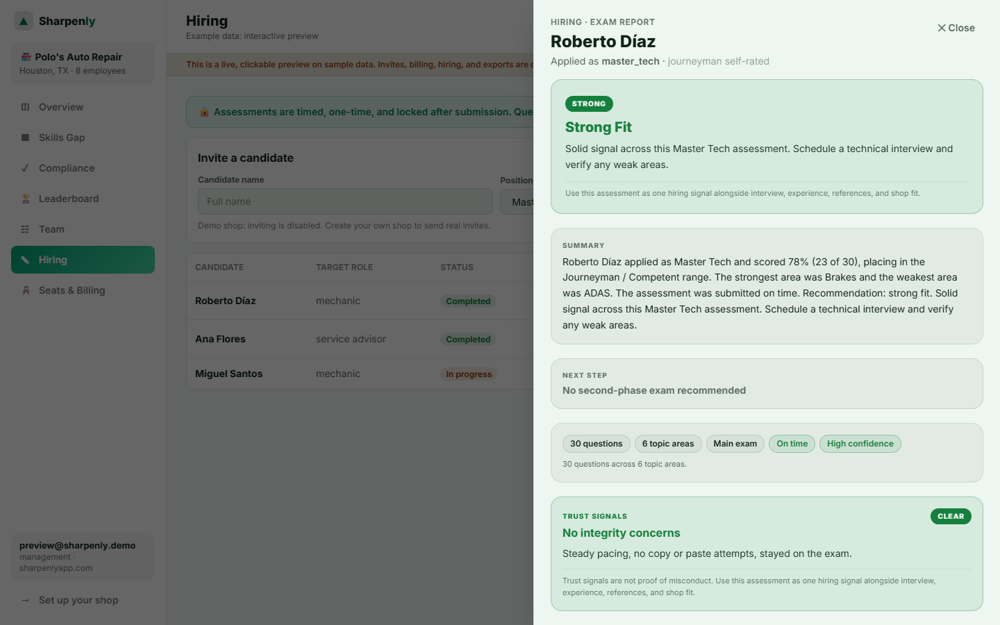</td>
    <td>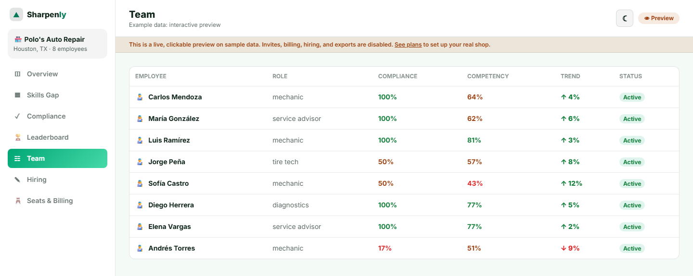</td>
  </tr>
  <tr>
    <td align="center">Overview</td>
    <td align="center">Candidate report</td>
    <td align="center">Team</td>
  </tr>
</table>

## For employees

Short quizzes, scenario questions, and lessons built from four typed section primitives: flashcard, hotspot, sequence, scenario. Progress, streaks, and a ranking keep people coming back.

<table align="center">
  <tr>
    <td>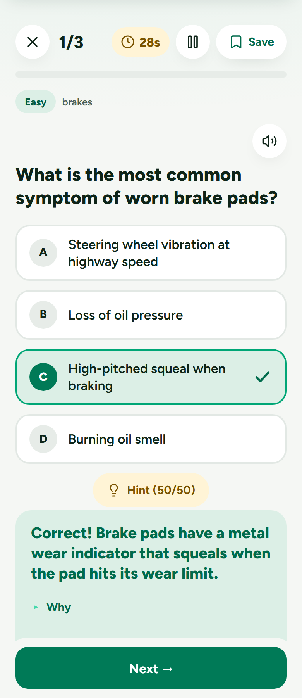</td>
    <td>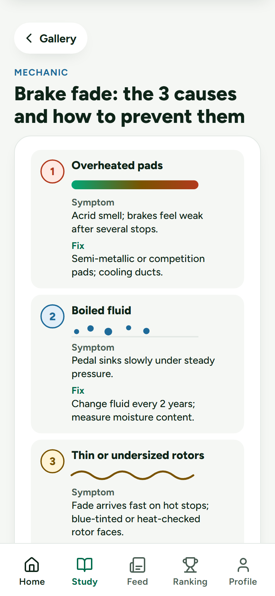</td>
    <td>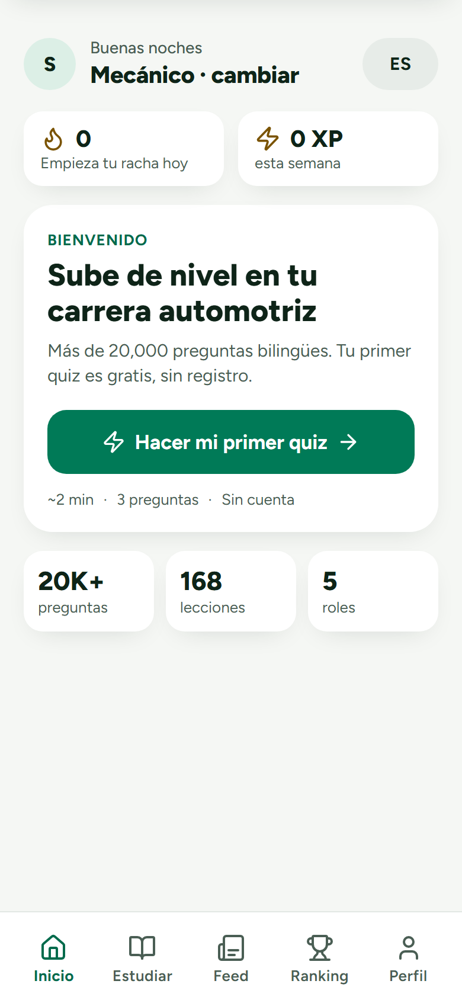</td>
    <td>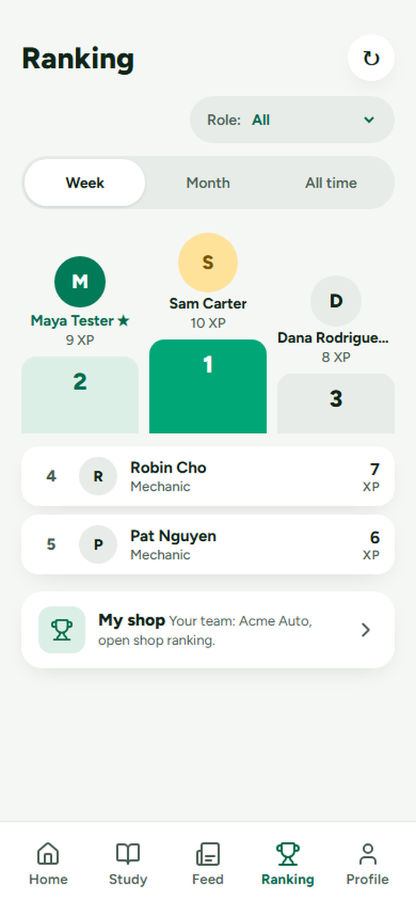</td>
  </tr>
  <tr>
    <td align="center">Quiz</td>
    <td align="center">Lesson</td>
    <td align="center">Home (Spanish)</td>
    <td align="center">Ranking</td>
  </tr>
</table>

## For candidates

A manager sends an invite link. The candidate takes a timed assessment. The manager gets a report card.

<table align="center">
  <tr>
    <td>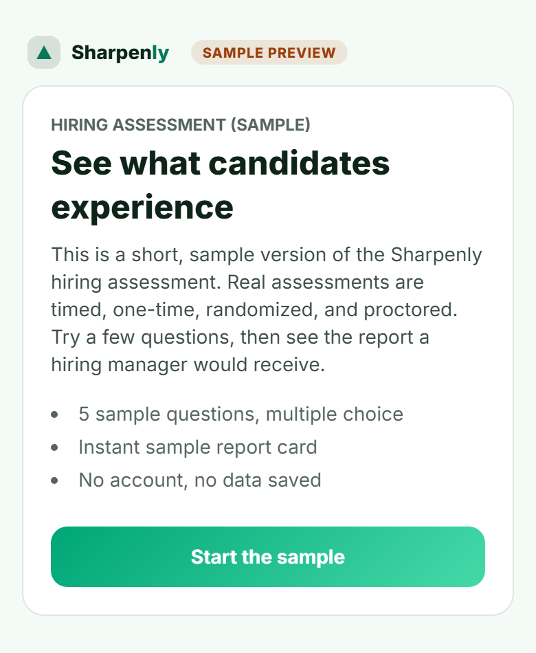</td>
    <td>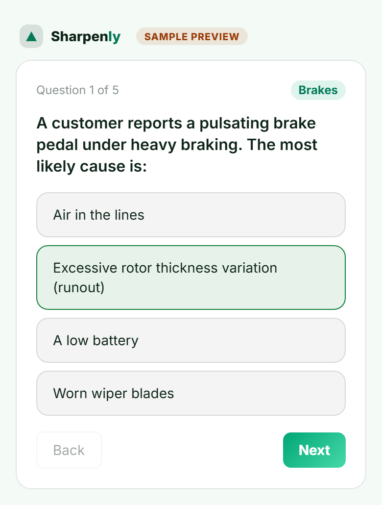</td>
  </tr>
  <tr>
    <td align="center">Intro</td>
    <td align="center">Exam</td>
  </tr>
</table>

## The AI content pipeline

Questions are generated from a curated corpus of automotive reference material. Nothing reaches a learner until it passes a rubric gate and a human check.

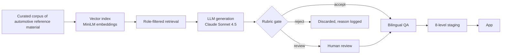

- Retrieval uses Chroma with `sentence-transformers/all-MiniLM-L6-v2`, filtered by role so a service-advisor question is grounded in service-advisor material.
- Each item must cite the passage it came from. Citations are stripped from this public repo.
- The gate checks structure, trivia, recall-style stems, theory that does not belong on a shop floor, answer-length giveaways, and near-duplicates by embedding similarity.
- A run only counts as a success if the output parsed and questions survived the gate. See the postmortem below.

## Data-quality work (what this proves)

| Skill | Artifact |
|---|---|
| Defining a quality rubric for training data | [data-quality/RUBRIC.md](data-quality/RUBRIC.md) |
| Turning a rubric into an automated gate | [data-quality/gate_excerpt.py](data-quality/gate_excerpt.py) |
| Bilingual validation (EN/ES alignment) | [data-quality/validators_excerpt.py](data-quality/validators_excerpt.py) |
| Measuring iteration: pilot, fix, repilot, full batch | [data-quality/README.md](data-quality/README.md) |
| Failure analysis and prevention rules | [data-quality/POSTMORTEM.md](data-quality/POSTMORTEM.md) |
| Real bilingual samples across roles and levels | [data-quality/samples/questions_sample.json](data-quality/samples/questions_sample.json) |

Headline result: first pilot accepted 14% of items. After tightening the prompt and the gate, a focused repilot accepted 84% with 0 rejected, and cost per kept item fell about 4.4x. A later batch where the API reported 617 of 617 requests "succeeded" produced 0 usable questions. That led to one rule: product success, not API success.

## Engineering

| Layer | Stack |
|---|---|
| App | Single-file PWA, service worker for offline, Firebase Realtime Database and Auth, Vercel |
| Site and dashboard | Next.js 16, TypeScript, Tailwind CSS 4, next-intl (EN/ES), Playwright and axe-core |
| Backend | 12 Firebase Cloud Functions (Node 22) |
| Content pipeline | Python, Chroma, sentence-transformers, Claude Sonnet 4.5 |

- Testing: 458 Python test functions, Playwright end-to-end tests, visual-regression baselines.
- CI: GitHub Actions for tests, a launch gate, and a weekly security job.
- Security: audits for XSS sinks, silent write failures, and public-data hygiene run before every release. A smoke test runs against the live deploy.

More detail in [docs/ARCHITECTURE.md](docs/ARCHITECTURE.md).

## About me

- Name: TODO
- LinkedIn: TODO
- Email: djsanti88@gmail.com
- GitHub: [djsanti88-sudo](https://github.com/djsanti88-sudo)

Open to AI data annotation, LLM evaluation, and AI training-data roles.

---

Copyright (c) 2026 Santiago. See [LICENSE.md](LICENSE.md).
