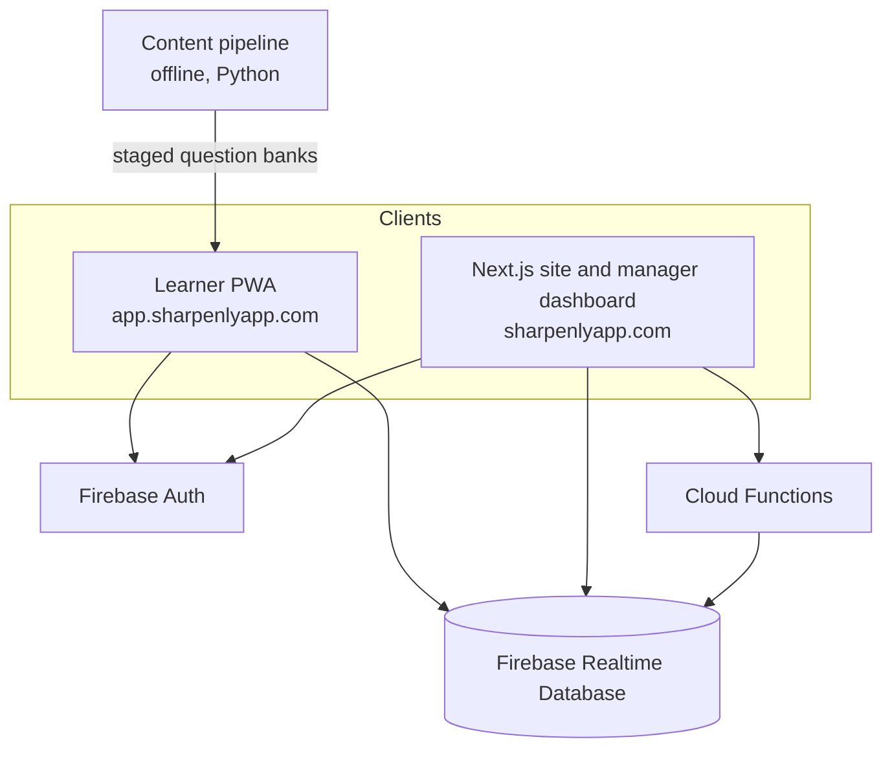

# Architecture overview

A short map of how Sharpenly fits together. The production source is private.

## Learner app (PWA)

- A single-file progressive web app, generated from source fragments by an assembly script. A check blocks release if the generated file drifts from its source.
- A service worker caches the app for offline use. Every shippable change bumps a cache version, so returning users get fresh assets.
- Firebase Realtime Database stores progress, scores, and shop membership. Firebase Auth handles sign-in.
- Progress is keyed by role and level name, not by question index. Re-shuffling or growing a question pool never corrupts saved progress.
- Content: 71 bank files, 20,308 bilingual questions, 168 lessons in 21 categories.

## Site and manager dashboard

- Next.js 16 with TypeScript and Tailwind CSS 4. English and Spanish through next-intl.
- Dashboard views: alerts, KPI tiles, skills-gap heatmap, compliance, employee drill-down, team controls, candidate reports, leaderboard, CSV export.
- Demo routes (`/manager-preview`, `/candidate-preview`) run on sample data with no login.
- Integrity "trust signals" are aggregate counts (tab hidden, paste events). They are shown as "review recommended", not as a verdict.

## Cloud Functions (12)

| Function | Purpose |
|---|---|
| `createShop` | Create a team workspace |
| `joinShop` | Join with a team code |
| `confirmMember` | Manager confirms a pending member |
| `manageMember` | Change a member's role or status, deactivate |
| `rotateJoinCode` | Replace the team join code |
| `startAssessment` | Begin a candidate assessment |
| `submitAssessment` | Score and store an assessment |
| `convertCandidate` | Promote a candidate to employee |
| `createCheckoutSession` | Start billing checkout (coded, not live) |
| `createBillingPortalSession` | Open the billing portal (coded, not live) |
| `stripeWebhook` | Receive billing events (coded, not live) |
| `reconcileBilling` | Scheduled daily billing reconciliation (coded, not live) |

## Three roles

| Role | Can do |
|---|---|
| Management | View the dashboard, assign training, manage the team, review and convert candidates |
| Employee | Train, see own progress, appear on the leaderboard |
| Candidate | Take the assessment through an invite link. Becomes an employee only when a manager converts them |

## Content pipeline

Offline Python pipeline. It does not run inside the app.

1. Index a curated corpus of automotive reference material into a Chroma vector store (`all-MiniLM-L6-v2`).
2. Retrieve passages filtered by role.
3. Generate bilingual questions with Claude Sonnet 4.5, with a citation to the retrieved passage.
4. Gate each item: accept, review, or reject. See [data-quality/](../data-quality/README.md).
5. Human review of the review pile.
6. Bilingual QA and near-duplicate audit of the bank.
7. Stage into 8 levels per track and validate the package.
8. Ship in a versioned app release.

Lessons use a separate YAML-first flow: a spec file per lesson, generated into JSON, then merged into the app. Sections are limited to four types: flashcard, hotspot, sequence, scenario.
